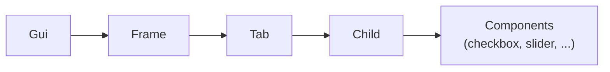

# Writing an Interface

This guide shows how to build a menu with Neverland UI, from the first window to a full multi-tab tool. It focuses on how the pieces fit together rather than listing every method; the [README](../README.md) has the complete reference tables, and [`demo/`](../demo) is a working example of everything shown here.

## The idea in one paragraph

You describe the interface **once**, at startup. Each `add…` call creates an element, attaches it to its parent and returns a pointer to it. From then on the framework does the rest every frame: layout, mouse and keyboard input, animation, scaling and drawing. Your code only hears about it when something changes, through the callbacks you registered.

There is no immediate-mode loop to write and no coordinates to compute for widgets.

## How an interface is structured

Every interface is the same four-level tree:



| Level | What it is | Created with |
|---|---|---|
| `ui::Gui` | The whole menu: windows, theme, fonts, keybinds. One per script. | a global variable |
| `ui::Frame` | A movable, resizable window. You can have several. | `gui.addFrame(title, position, size)` |
| `ui::Tab` | A page inside a window. A tab bar appears once a window has two or more. | `frame->addTab(label)` |
| `ui::Child` | A titled group box that holds components. | `tab->addChild(title)` |
| Components | The actual controls. | `child->addCheckbox(...)`, `child->addSliderInt(...)`, ... |

Components always live inside a child, children inside a tab, tabs inside a frame.

## Your first window

```cpp
#include "ui/ui.em"

ui::Gui g_objGui;

int64 main() {
    ui::Frame* pFrameMain = g_objGui.addFrame("My tool", vec2(100.0, 100.0), vec2(640.0, 420.0));
    ui::Tab* pTabGeneral = pFrameMain->addTab("General");
    ui::Child* pChildOptions = pTabGeneral->addChild("Options");

    pChildOptions->addCheckbox("Enabled")
        ->onChange([](bool bEnabled) { println("enabled: " + std::to_string(bEnabled)); });
    pChildOptions->addSliderFloat("Strength", 0.0, 1.0, 0.5)
        ->onChange([](float64 fValue) { println(std::format("strength: {:.2f}", fValue)); });

    ui::startRendering(g_objGui);
    return 1;
}
```

Three things matter here:

- **The `Gui` is a global.** `startRendering` hands its address to a per-frame routine, so it has to outlive `main`. A local `Gui` would be destroyed the moment `main` returns.
- **`main` returns `1`** so the script stays loaded and the routine keeps running.
- **`Insert` shows and hides the menu.** Change it with `g_objGui.setToggleKey(vk::home)`.

## Layout is automatic

You never position a component. The rules are simple:

- **Children are placed in two columns.** The first child goes left, the second right, the third starts a new row, and so on. Each row is as tall as its taller child.
- **Components stack vertically** inside their child, in the order you add them.
- **Each component row** puts the control on the left and its label on the right, like egui.
- **Tabs scroll** with the mouse wheel or a scrollbar when their content is taller than the window.

So the order of your `add…` calls *is* the layout. To change the arrangement, change the order.

## Components all work the same way

Once you know one component, you know them all. Every component follows the same pattern:

1. **Create it** on a child with `addX(label, ...)`. The extra arguments are the initial state (range and value, item list, color...).
2. **Configure it** by chaining setters such as `setSuffix`, `setDecimals` or `setMaximumLength`.
3. **React to it** with a callback, usually `onChange`.
4. **Read or set its state** later through the pointer you got back.

```cpp
ui::SliderInt* pSliderIntDelay = pChildTrigger->addSliderInt("Reaction delay", 0, 500, 120)
    ->setSuffix(" ms")
    ->onChange([](int64 iValue) { println("delay = " + std::to_string(iValue)); });

int64 iDelay = pSliderIntDelay->value();
pSliderIntDelay->setValue(200);
```

Setters that return the component can be chained; `onX` callbacks always can.

The available components, and only what differs between them:

| Component | Created with | Callback receives |
|---|---|---|
| Label | `addLabel(text)` | `onClick()` |
| Button | `addButton(label)` | `onClick()` |
| Checkbox | `addCheckbox(label[, checked])` | `onChange(bool)` |
| Integer slider | `addSliderInt(label, min, max, value)` | `onChange(int64)` |
| Decimal slider | `addSliderFloat(label, min, max, value)` | `onChange(float64)` |
| Combo box | `addCombobox(label, items[, index])` | `onChange(int64 index, item)` |
| Multi combo box | `addMultiCombobox(label, items)` | `onChange(int64 index, item, bool selected)` |
| List box | `addListbox(label, items)` | `onSelect(int64 index, item)` |
| Text field | `addTextfield(label[, placeholder])` | `onChange(text)` while typing, `onSubmit(text)` on Enter |
| Color picker | `addColorPicker(label, color)` | `onChange(color)` |

Item lists are written inline: `addCombobox("Bone", { "Head", "Neck", "Chest" })`.

### Callbacks fire for the user, not for your code

A callback runs when the **user** changes something: clicking, dragging, typing, using a keybind or pasting a value. Calling `setValue`, `setChecked` or `setText` from your own code changes the component quietly. That means you can sync components with each other without callbacks bouncing back and forth.

### Talking to other components from a callback

Callbacks are lambdas. To use another component inside one, capture its pointer:

```cpp
ui::Textfield* pTextfieldName = pChildProfile->addTextfield("Username", "Enter a name...");
pChildProfile->addButton("Save")->onClick([pTextfieldName]() {
    println("saving " + pTextfieldName->text());
});
```

The framework owns every element it creates. The pointers stay valid as long as the `Gui` exists, and you never `delete` them.

## Things every element can do

These work on any component, and most also on children, tabs and frames:

| Call | Effect |
|---|---|
| `onHover(fn)` | `fn(bool)` when the mouse enters or leaves |
| `setColor(role, color)` | Overrides one theme color for this element **and everything inside it** |
| `setEnabled(false)` | Components only: greys it out and ignores input |
| `setTabOrder(n)` | Components only: position in the Tab-key order |
| `bindKey(key, mode)` | Components only: attaches a keybind (see below) |

Frames add window controls: `setPosition`, `setSize`, `setMinimumSize`, `setResizable`, `setMovable`, `setVisible`, `selectTab`, and the `onMove` / `onResize` callbacks. Tabs add `onSelect` and icons.

## Organizing a larger interface

Building everything in `main` gets unwieldy fast. The demo uses a pattern that scales well:

- **One struct** holds pointers to the components you need to read or change later.
- **One build function per tab** fills that struct.
- **`main`** sets up fonts and the toggle key, calls the builders and starts rendering.

```cpp
struct MenuInterface {
    ui::Checkbox* pCheckboxAimEnabled = null;
    ui::SliderFloat* pSliderFloatSmoothing = null;
};

void buildCombatTab(ui::Frame* pFrameMain, MenuInterface& objMenuInterface) {
    ui::Child* pChildAim = pFrameMain->addTab("Combat")->addChild("Aim assist");
    objMenuInterface.pCheckboxAimEnabled = pChildAim->addCheckbox("Enabled");
    objMenuInterface.pSliderFloatSmoothing = pChildAim->addSliderFloat("Smoothing", 0.0, 1.0, 0.35);
}
```

Elsewhere in your script you can then simply read `objMenuInterface.pCheckboxAimEnabled->isChecked()`. Polling values like this and reacting in callbacks are both fine; use whichever suits the feature.

See [`demo/demo_interface.em`](../demo/demo_interface.em) for the full version, including a second "Live status" window that updates from callbacks.

## What the framework handles for you

All of the following works without extra code. Where a feature has an API, it is a line or two.

### Keybinds

Any component can be bound to a key. A small key box appears in its row; the user can left-click it to rebind (Escape clears it) and right-click it to switch modes.

```cpp
pCheckboxAim->bindKey(vk::f, ui::KeybindMode::OnToggle)
    ->onStateChange([](bool bActive) { println(bActive ? "aim on" : "aim off"); });
```

| Mode | The component's callbacks fire... |
|---|---|
| `AlwaysOn` | always |
| `OnToggle` | after the key toggled the bind on (starts off) |
| `OffHotkey` | always, except while the key is held |

Keybinds that belong to no component come from `g_objGui.addKeybind("Panic", vk::end, ui::KeybindMode::OnToggle)`. Keybinds keep working while the menu is hidden and are ignored while the user types in a text field.

### Copy and paste values

Right-clicking any component opens a menu with **Copy value** and **Paste value**. Values are typed: a slider value can be pasted into another slider, a color into a color picker, an item name into a combo box. Incompatible pastes are refused with a reason ("Cannot paste text into a checkbox"). Values also go to the system clipboard as text, so pasting `#FF8800` copied from a browser into a color picker works.

### Typing exact values

Sliders behave like egui's drag values: drag them, or **Ctrl+click** (or just click the value box) to type a number. Typed values are clamped to the range. The color picker's channel and hex fields work the same way.

### Keyboard navigation

**Tab** and **Shift+Tab** move focus through the components of the current tab. A focused component responds to Space, Enter and the arrow keys. `setTabOrder(n)` puts components first in the order you choose.

### DPI scaling

Design your interface for 1920×1080. The menu scales automatically with the overlay's resolution (1.33× at 1440p, 2× at 4K), and fonts and icons are re-rendered at the real pixel size so they stay sharp. Users who want it larger or smaller can be given a setting that calls `g_objGui.setScale(1.25)`.

### SVG icons

Tabs can carry an SVG icon, passed as markup (not a file path):

```cpp
pFrameMain->addTab("Combat", strCrosshairSvg);          // tinted with the theme colors
pTabAbout->setIcon(strLogoSvg, ui::SvgColorMode::Original);  // keeps the SVG's own colors
pTabAbout->setIconOnly(true);                            // no label, just the icon
```

The built-in renderer handles the common SVG elements and attributes (paths with all commands, basic shapes, groups, transforms, fills, strokes, opacity), so icon sets such as Lucide work as-is.

### Themes and colors

A dark (default) and a light preset, both based on egui's look. Change the accent color in one line, override any single color globally, or override it for one element and everything inside it.

```cpp
g_objGui.setTheme(ui::Theme::light());
g_objGui.theme().setAccent(color(24, 110, 78, 255));
pButtonDanger->setColor(ui::ColorRole::WidgetFill, color(96, 30, 42, 255));
```

Spacing, rounding and sizes live in `g_objGui.theme().metrics()`.

### Fonts

```cpp
g_objGui.fonts().setFontFamily("Bahnschrift");
g_objGui.fonts().setFont(ui::FontRole::Title, "Segoe UI Semibold", 16.0);
```

Fonts can be named by family, file name or full path, or loaded from memory. A font that fails to load falls back gracefully to a system font instead of breaking the menu.

### Windows and input

Several windows can be open at once. They are dragged by the title bar, resized from the edges or corner, brought to the front on click, and kept on screen. While the menu is open, clicks on it are captured so they don't fall through to the desktop.

## Where to go next

- [`README.md`](../README.md): full reference tables, paste rules, theme roles, custom render and input backends.
- [`demo/demo.em`](../demo/demo.em): load it in Perception to try every feature.
- [`tests/interaction_tests.em`](../tests/interaction_tests.em): runs the demo headless with scripted input; handy as executable documentation of the exact behavior.
